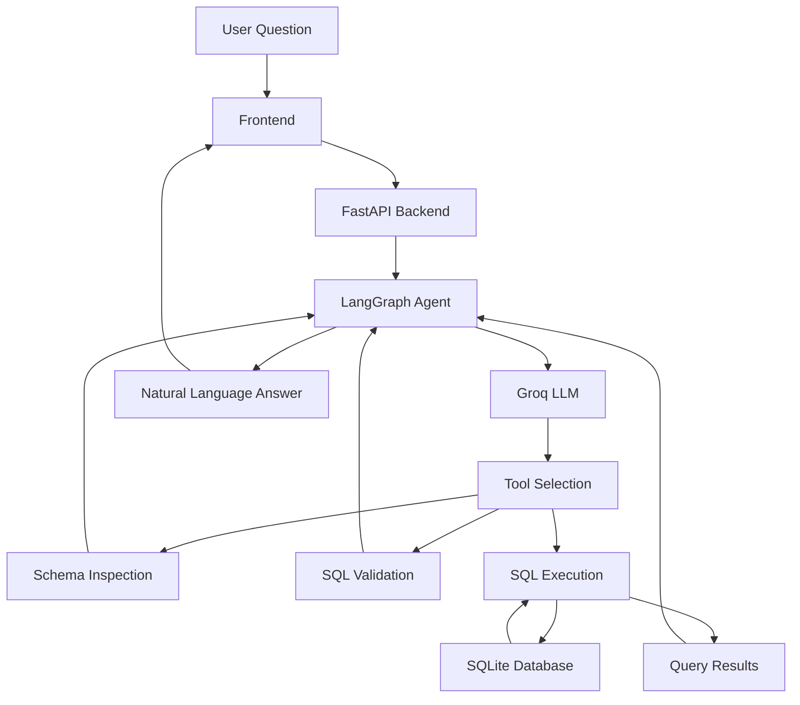

# Natural Language SQL Agent

An AI-powered SQL assistant that allows users to query relational databases using natural language. Built with **Python, LangGraph, LangChain, Groq, FastAPI and SQLite**, with SQL validation, read-only execution, error recovery and Docker-based deployment.

<p align="center">
  <a href="https://mysqlagent.up.railway.app/">
    <strong>Live Demo →</strong>
  </a>
</p>

---

## Application Preview

<!-- Replace frontend-screenshot.png with the actual screenshot filename inside the root images/ directory. -->


---

## Overview

Natural Language SQL Agent converts user questions into SQL queries, validates them, executes them against a relational database and presents the results in natural language.

Instead of manually writing SQL, users can ask questions such as:

- Which five products generated the highest revenue?
- How many orders are there in each status?
- Which customers placed the most orders?
- What is the total revenue from shipped and delivered orders?

The application uses a **LangGraph-based agent workflow** to coordinate database inspection, SQL validation and query execution tools.

## Architecture



## Agent Workflow

The agent follows a controlled tool-calling workflow:

1. **Schema Inspection:** Retrieves database tables, columns, data types and relationships.
2. **SQL Generation:** Generates SQL based on the user's question and database schema.
3. **SQL Validation:** Validates the generated query before execution.
4. **SQL Execution:** Executes validated read-only queries against SQLite.
5. **Error Recovery:** Analyzes tool failures and allows the agent to correct unsuccessful queries.
6. **Response Generation:** Produces a natural-language explanation of the query results.

LangGraph manages agent state, tool execution, conditional routing and error recovery.

## Key Features

### Agentic SQL Generation
- Natural-language-to-SQL conversion.
- Schema-aware query generation.
- Tool calling using LangChain and LangGraph.
- Structured agent state and workflow orchestration.

### SQL Validation and Execution Security
- SQL parsing and validation using SQLGlot.
- SQLite dialect validation.
- Single-statement enforcement.
- SELECT-only query policy.
- SQLite authorizer for database-operation restrictions.
- SQLite read-only query mode.
- Restrictions on potentially dangerous SQL functions.
- SQL AST complexity limits.
- SQLite runtime resource limits.
- Five-second SQL execution timeout.
- Maximum 100 returned rows per query.
- Connection cleanup and state restoration.
- Sanitized database execution errors.

### Agent Reliability
- Two recovery attempts after tool failures.
- Maximum 12 tool calls per request.
- LangGraph recursion limit.
- Configurable Groq request timeout and retries.
- Structured LLM provider error handling.
- Fail-closed API success policy.

### Backend and Frontend
- FastAPI REST endpoints.
- Pydantic request validation.
- Basic per-client API rate limiting.
- Interactive web interface.
- Generated SQL display.
- Query result visualization.
- Error and loading states.

### Deployment
- Dockerized application.
- Docker Compose configuration.
- Non-root container execution locally.
- Persistent SQLite storage using Docker volumes.
- Railway cloud deployment.

## Technology Stack

| Category | Technologies |
|---|---|
| Programming Language | Python 3.12 |
| LLM Provider | Groq |
| Agent Framework | LangGraph |
| LLM Integration | LangChain |
| Backend | FastAPI |
| SQL Parsing | SQLGlot |
| ORM | SQLAlchemy |
| Database | SQLite |
| Frontend | HTML, CSS, JavaScript |
| Containerization | Docker, Docker Compose |
| Deployment | Railway |
| Testing | Pytest |

## Project Structure

```text
natural-language-sql-agent/
│
├── app/
│   ├── agent/
│   │   ├── graph.py
│   │   ├── state.py
│   │   ├── prompts.py
│   │   ├── recovery.py
│   │   └── provider_errors.py
│   │
│   ├── api/
│   │   ├── routes.py
│   │   └── rate_limit.py
│   │
│   ├── database/
│   │   ├── connection.py
│   │   ├── models.py
│   │   └── seed.py
│   │
│   ├── tools/
│   │   ├── schema_tool.py
│   │   ├── validation_tool.py
│   │   └── sql_tool.py
│   │
│   └── main.py
│
├── frontend/
│   ├── index.html
│   ├── style.css
│   └── script.js
│
├── images/
│   └── frontend-screenshot.png
│
├── tests/
│   ├── test_tools.py
│   ├── test_agent.py
│   ├── test_api.py
│   └── test_provider_errors.py
│
├── docs/
│
├── Dockerfile
├── compose.yaml
├── .dockerignore
├── .env.example
├── requirements.txt
├── requirements-dev.txt
└── README.md
```

## Database Design

The application uses SQLite with SQLAlchemy ORM.

The database contains four related tables:

| Table | Description |
|---|---|
| `customers` | Customer information |
| `products` | Product details and prices |
| `orders` | Customer orders and their statuses |
| `order_items` | Products associated with orders, quantities and unit prices |

### Seed Dataset

The project includes synthetic sample data:

| Table | Records |
|---|---:|
| Customers | 100 |
| Products | 25 |
| Orders | 500 |
| Order Items | 1,271 |

The database seeding script creates missing tables and prevents duplicate sample data from being inserted when the database is already populated.

### Revenue Calculation

For revenue-related questions, the application follows this business rule:

**Revenue = SUM(quantity × unit_price)**

Only orders with `shipped` or `delivered` status are included. Pending and cancelled orders are excluded.

## API Documentation

The FastAPI backend exposes the following endpoints:

| Method | Endpoint | Description |
|---|---|---|
| GET | `/api/health` | Application health check |
| GET | `/api/schema` | Retrieve database schema |
| POST | `/api/ask` | Submit a natural-language question |

### Example Request

```http
POST /api/ask
Content-Type: application/json
```

```json
{
  "question": "Which five products generated the highest revenue? Use only shipped and delivered orders."
}
```

### Example Response

```json
{
  "success": true,
  "answer": "The top five products by revenue are...",
  "sql": "SELECT ...",
  "columns": [
    "product_id",
    "product_name",
    "revenue"
  ],
  "rows": [
    {
      "product_id": 17,
      "product_name": "Tablet",
      "revenue": 1823904
    }
  ],
  "row_count": 5,
  "truncated": false
}
```

The frontend displays the natural-language answer, generated SQL and query results separately.

Interactive API documentation is available at `/docs`.

## Getting Started

### Prerequisites

- Python 3.12+
- Git
- Groq API key

### 1. Clone the Repository

```bash
git clone https://github.com/rushee-67/natural-language-sql-agent.git

cd natural-language-sql-agent
```

### 2. Create a Virtual Environment

```bash
python -m venv .venv

source .venv/bin/activate
```

### 3. Install Dependencies

```bash
pip install -r requirements-dev.txt
```

### 4. Configure Environment Variables

Create your local environment file:

```bash
cp .env.example .env
```

Configure:

```env
GROQ_API_KEY=your_groq_api_key
GROQ_MODEL=openai/gpt-oss-20b
GROQ_REQUEST_TIMEOUT_SECONDS=30
GROQ_MAX_RETRIES=2
SQLITE_DB_PATH=
```

Obtain your API key from [Groq Console](https://console.groq.com/).

An empty `SQLITE_DB_PATH` uses the default database location in the project root.

Never commit your `.env` file or expose your API key.

### 5. Initialize the Database

```bash
python -m app.database.seed
```

### 6. Run the Application

```bash
uvicorn app.main:app --reload
```

Open:

- Frontend: http://127.0.0.1:8000/
- API documentation: http://127.0.0.1:8000/docs
- Health check: http://127.0.0.1:8000/api/health

## Docker Setup

The application includes a Dockerfile and Docker Compose configuration.

### Build the Image

```bash
docker compose build
```

### Start the Application

```bash
docker compose up -d
```

### Check Container Status

```bash
docker compose ps
```

### View Application Logs

```bash
docker compose logs -f app
```

### Stop the Application

```bash
docker compose down
```

The SQLite database is stored in a persistent Docker volume mounted at `/data`. Database records survive container recreation.

**Note:** Avoid `docker compose down -v` unless you intentionally want to remove the persistent database volume.

## Live Deployment

The application is deployed on **Railway** using Docker.

**Live Application:** https://mysqlagent.up.railway.app/

Deployment configuration includes:

- Docker-based application builds.
- Runtime environment variables for Groq configuration.
- Dynamic application port configuration.
- Persistent volume mounted at `/data`.
- SQLite database initialization on startup.
- Container health checks.

## Testing

The project uses Pytest to test database tools, SQL validation, agent execution, recovery mechanisms, API endpoints and provider error handling.

Run the complete test suite:

```bash
python -m pytest -v
```

## Security Considerations

The application implements multiple layers of SQL execution protection:

1. SQLGlot-based SQL validation.
2. SELECT-only statement enforcement.
3. SQLite authorizer restrictions.
4. SQLite read-only query mode.
5. SQL AST complexity limits.
6. SQLite runtime resource limits.
7. Query execution timeout.
8. Maximum returned row limit.
9. Sanitized database execution errors.
10. Agent tool-call and graph execution limits.

These protections are intended for a controlled demonstration application. The current application does not implement user authentication or multi-tenant authorization. Its in-memory rate limiter is intended for a single application process.

Do not use it with sensitive production data or expose it as a multi-user database service without additional access controls.

## Future Improvements

- Authentication and authorization.
- Support for additional database engines.
- Conversation history and session management.
- Query result export.
- Enhanced observability and monitoring.

---

<p align="center">
  <strong>Built with Python, LangGraph, FastAPI and SQLite.</strong>
</p>